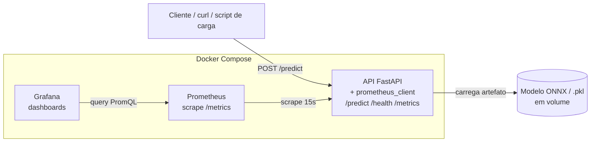
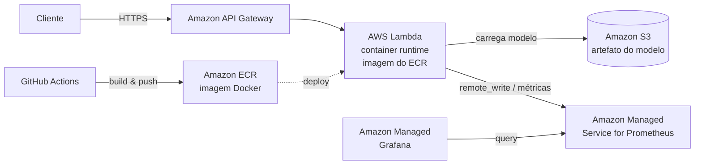
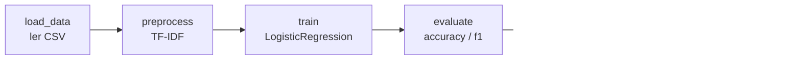
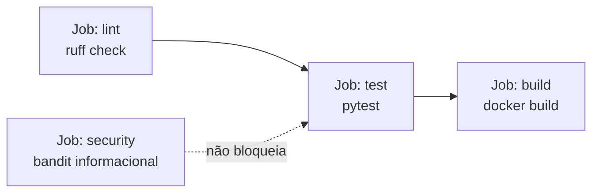
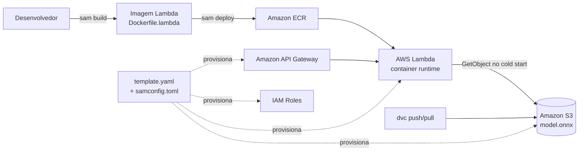

# Design Document

## Visão Geral

Este documento descreve o design técnico do sistema de **triagem automática de laudos médicos**. O sistema classifica textos de laudos em três níveis de urgência (`normal`, `atencao`, `urgente`) usando um pipeline leve de NLP (TF-IDF + Logistic Regression), servido por uma API REST (FastAPI) containerizada.

O design cobre os dois ambientes-alvo:
- **Local (desenvolvimento/demonstração)**: Docker Compose com API + Prometheus + Grafana.
- **Nuvem (produção)**: AWS Lambda com runtime de container atrás do API Gateway, observabilidade via Amazon Managed Prometheus (AMP) + Amazon Managed Grafana (AMG).

O foco é demonstrar um ciclo de MLOps completo e observável, com baixa latência de inferência (meta: p95 < 100 ms local).

### Mapa Requisito → Seção de Design
| Requisito | Seção(ões) de Design |
|-----------|----------------------|
| R1 Modelo de ML | Pipeline de ML, Treino |
| R2 API REST | Componente API, Contratos |
| R3 Docker | Containerização |
| R4 CI/CD | Pipeline CI/CD |
| R5 Airflow | Orquestração de Treino |
| R6 Monitoramento local | Observabilidade (local) |
| R7 Otimização latência | Otimização ONNX, Benchmark |
| R8 Qualidade de repositório | Estrutura de Pastas, Testes |
| R9 Dados | Dataset e Pré-processamento |
| R10 Decisão AWS | Arquitetura de Nuvem (AWS), Deploy na AWS (SAM) |
| R11 Benchmark + vídeo | Benchmark, Entrega |

---

## Arquitetura

### Arquitetura Local (Docker Compose)



### Arquitetura de Nuvem Alvo (AWS)



### Fluxo de Retreino (Airflow)



A DAG mínima exigida pelo enunciado é `load_data → train → save`. As tarefas `preprocess`, `evaluate` e `export_onnx` são detalhamentos coesos dentro desse fluxo, mantendo a DAG funcional e didática.

---

## Componentes e Interfaces

### 1. Pipeline de ML (`src/model/`)

**Responsabilidade**: treinar, avaliar, serializar e exportar o classificador.

Componentes:
- `preprocessing.py` — normalização de texto (lowercase, remoção de pontuação/stopwords básicas) e vetorização TF-IDF.
- `train.py` — monta o `Pipeline` scikit-learn (`TfidfVectorizer` + `LogisticRegression`), treina com seed fixa, avalia e persiste o artefato `.pkl`.
- `export_onnx.py` — converte o pipeline treinado para ONNX via `skl2onnx`, salvando `model.onnx`.
- `inference.py` — carrega o artefato (ONNX Runtime por padrão, fallback `.pkl`) e expõe `predict(text) -> {label, score}`.

Decisão: o `TfidfVectorizer` e o `LogisticRegression` são exportados juntos como um único grafo ONNX (`skl2onnx` suporta o pipeline completo), evitando divergência entre pré-processamento de treino e de inferência.

### 2. API REST (`src/api/`)

**Responsabilidade**: expor inferência via HTTP e instrumentar métricas.

- Framework: **FastAPI** + Uvicorn.
- O modelo é carregado **uma vez** no startup (evento `lifespan`), não por requisição (R2.6).
- Para a nuvem, a mesma aplicação é empacotada com um adaptador (ex.: `mangum`) para rodar em Lambda sem reescrever a lógica.

#### Endpoints

| Método | Rota | Descrição |
|--------|------|-----------|
| POST | `/predict` | Classifica um laudo. |
| GET | `/health` | Health check (status + modelo carregado). |
| GET | `/metrics` | Métricas no formato Prometheus. |

#### Contratos (schemas Pydantic)

```jsonc
// POST /predict  (request)
{
  "text": "Patient presents with acute chest pain and shortness of breath"
}

// POST /predict  (response 200)
{
  "label": "urgente",
  "score": 0.93,
  "scores": { "normal": 0.02, "atencao": 0.05, "urgente": 0.93 },
  "model_version": "onnx-v1",
  "inference_ms": 4.1
}

// erro de validação (422) — text vazio/ausente
{ "detail": [ { "loc": ["body","text"], "msg": "...", "type": "..." } ] }

// modelo indisponível (503)
{ "detail": "model not loaded" }
```

```jsonc
// GET /health (200)
{ "status": "ok", "model_loaded": true, "model_version": "onnx-v1" }
```

Regras de validação (R2.4, R1.5):
- `text`: string obrigatória, `min_length=1` após `strip()`; caso contrário → 422.
- Se o modelo não estiver carregado no startup → `/predict` responde 503; `/health` responde `model_loaded: false`.

### 3. Instrumentação de Métricas (R6)

Usando `prometheus_client`, via middleware/decorator na API:

| Métrica | Tipo | Labels | Uso no dashboard |
|---------|------|--------|------------------|
| `http_requests_total` | Counter | `method`, `endpoint`, `status_code` | Painel "Total de requisições" + taxa de erro |
| `http_request_duration_seconds` | Histogram | `endpoint` | Painel "Latência" (p50/p95 via `histogram_quantile`) |
| `prediction_total` | Counter | `label` | (extra) distribuição de classes previstas |
| `model_inference_duration_seconds` | Histogram | — | latência isolada da inferência (sem overhead HTTP) |

O endpoint `/metrics` é exposto por `generate_latest()`. O histograma de duração permite calcular p95 (atende R7.4 / dashboard de latência).

Taxa de erro (painel 3): derivada de `http_requests_total` filtrando `status_code=~"5.."` sobre o total.

### 4. Containerização (R3)

- **Imagem local/API**: base `python:3.11-slim`, instala dependências de `requirements.txt`, copia `src/` e o artefato do modelo, expõe porta `8000`, `CMD` com Uvicorn.
- **Imagem Lambda**: base `public.ecr.aws/lambda/python:3.11`, handler via `mangum`. Duas variantes de Dockerfile (`Dockerfile` para servidor local, `Dockerfile.lambda` para AWS) compartilhando o mesmo código de aplicação. O build e o push da imagem Lambda para o ECR são conduzidos pelo **AWS SAM** (`sam build` / `sam deploy`), ver seção "Deploy na AWS".
- Otimização de tamanho: imagem slim, `--no-cache-dir` no pip, `.dockerignore` para excluir dados/testes/artefatos de dev.

### 5. Orquestração de Treino — Airflow (R5)

- DAG `train_triage_model` em `airflow/dags/train_triage_model.py`.
- Tarefas via `PythonOperator` reutilizando funções de `src/model/` (sem duplicar lógica).
- `load_data`: lê o CSV de `data/`. `train`: treina o pipeline. `export_onnx`: exporta. `save_artifacts`: grava modelo + `metrics.json`.
- `schedule_interval=None` (trigger manual) com possibilidade de agendamento documentada (R5.5).
- `default_args` com `retries` controlados; falha em qualquer task interrompe as dependentes (R5.4, comportamento padrão do Airflow).

### 6. Pipeline CI/CD — GitHub Actions (R4)

Workflow `.github/workflows/ci.yml`, disparado em `push` e `pull_request`:



- **lint**: `ruff check` sobre `src/` e `tests/` (bloqueante).
- **security (Bandit)**: `bandit -r src/` como análise estática de segurança do código Python. Executa em **modo informacional** — reporta findings mas **não bloqueia** o pipeline (ex.: `continue-on-error: true` ou flags que não falham o job). Cumpre a boa prática de SAST sem travar a entrega.
- **test**: `pytest` (testes de API e inferência) — bloqueante.
- **build**: `docker build` da imagem de inferência; só executa após `lint` e `test` passarem (via `needs:`). Falha de lint/test bloqueia o build e o merge (R4.4). O job `security` não é pré-requisito do build (não bloqueia).

Isso mantém o mínimo de 2 automações bloqueantes exigidas (lint + test) e adiciona segurança (Bandit) como camada informacional.

### 7. Dataset e Pré-processamento (R9)

- **Estratégia padrão (dataset público)**: utilizar o **Medical Abstracts TC Corpus** (classificação de textos médicos em inglês, > 2.000 amostras) como fonte primária. Um script `src/data/prepare_dataset.py` baixa/carrega os dados brutos e mapeia os rótulos originais para as 3 classes de urgência `{normal, atencao, urgente}`.
- **Versionamento com DVC**: como o dataset é externo e grande demais para versionar via Git, o projeto usa **DVC** para rastrear `data/` de forma reproduzível:
  - `dvc.yaml` define o estágio `prepare_dataset` (dados brutos → `data/laudos.csv`).
  - `data/laudos.csv.dvc` versiona o ponteiro do dataset processado; o `.csv` em si fica gitignored.
  - **Remote DVC = o mesmo bucket S3 do modelo** (R10): o S3 é fonte única de verdade — versiona os dados do dataset (via DVC) e serve o `model.onnx` para a Lambda em runtime. Para o CI, o estágio pode ser reproduzido localmente (`dvc repro`) ou os dados baixados via `dvc pull`.
- **Fallback para CI/offline**: se o download do dataset público não estiver disponível no ambiente de CI, um pequeno gerador sintético (`src/data/generate_dataset.py`) produz amostras rotuladas suficientes para rodar testes de forma determinística, sem bloquear o pipeline.
- Saída canônica: `data/laudos.csv` com colunas `text,label`.
- **Mapeamento de rótulos**: a lógica de conversão dos rótulos do corpus público para `{normal, atencao, urgente}` é documentada e centralizada em `prepare_dataset.py` (R9.4).
- Pré-processamento: embutido no `TfidfVectorizer` (lowercase, `stop_words='english'`, `ngram_range=(1,2)`); split treino/teste com `train_test_split(..., random_state=42, stratify=y)` (R9.7).

**Nota de design — DVC:** o DVC foi adicionado por o dataset ser público/externo e precisar de versionamento reproduzível sem inchar o Git. O remote S3 reaproveita a mesma conta/arquitetura AWS prevista no R10. O DVC é opcional para quem só quer rodar os testes (o fallback sintético cobre o CI), mas é o caminho recomendado para reproduzir o treino com dados reais.

### 8. Otimização de Latência — ONNX (R7, R11)

- Exportação com `skl2onnx.convert_sklearn` do pipeline completo.
- Inferência com `onnxruntime.InferenceSession`.
- **Benchmark** (`scripts/benchmark.py`): mede latência de N requisições (ex.: 1000) para o modelo `.pkl` (sklearn) vs. `.onnx` (ONNX Runtime), reportando p50/p95/média e ganho percentual, gravando `benchmark_results.md`/`.json`.
- Trade-off de acurácia (R7.5): o script compara também accuracy/f1 do `.pkl` vs `.onnx` para documentar que a conversão preserva a qualidade.

#### Nota sobre cold start em Lambda
A meta p95 < 100 ms refere-se ao **ambiente local** (R7.4/R11). Em Lambda com container, o cold start adiciona latência de inicialização. O design prevê: artefato ONNX pequeno + modelo carregado fora do handler (escopo global, reutilizado entre invocações warm). *Provisioned concurrency* é citado no README como mitigação opcional, fora do escopo de implementação local.

---

## Deploy na AWS (IaC com AWS SAM) — R10

### Visão geral
O deploy em nuvem é descrito como **Infraestrutura como Código** usando **AWS SAM** (`template.yaml`). O deploy é **manual e documentado** (não automatizado no GitHub Actions — o CI é dedicado a MLOps). O artefato do modelo (`model.onnx`) vive em um bucket **Amazon S3**, que é também o **remote do DVC**: a mesma origem versiona o dado para o treino e serve o modelo para a Lambda em runtime.

### Fluxo de deploy



### Recursos provisionados pelo SAM (`template.yaml`)
| Recurso | Tipo SAM/CloudFormation | Função |
|---------|-------------------------|--------|
| Função de inferência | `AWS::Serverless::Function` (`PackageType: Image`) | Executa a API (FastAPI via `mangum`) a partir da imagem de container |
| API HTTP | `AWS::Serverless::HttpApi` (ou eventos `Api` na função) | Expõe `/predict`, `/health`, `/metrics` publicamente |
| Bucket do modelo | `AWS::S3::Bucket` (ou referência a bucket existente via parâmetro) | Armazena `model.onnx`; remote do DVC |
| IAM Role da Lambda | `AWS::IAM::Role` (gerado pelo SAM) | Permite `s3:GetObject` no bucket do modelo e logs no CloudWatch |

O ECR da imagem é gerenciado pelo próprio SAM (`sam deploy` com `--resolve-image-repos` ou repositório declarado), evitando criação manual.

### Carregamento do modelo em runtime
- No **cold start**, o handler (escopo global, fora da função de invocação) faz `s3:GetObject` do `model.onnx` para `/tmp` e inicializa a `InferenceSession` do ONNX Runtime uma única vez.
- Em invocações **warm**, a sessão já carregada é reutilizada (sem novo download).
- O bucket/chave do modelo são passados por **variável de ambiente** da Lambda (parametrizada pelo SAM), nunca hardcoded.

### Parametrização (requisito explícito)
O deploy é totalmente parametrizável, sem valores fixos no código:
- **`template.yaml` → `Parameters`**: `ModelBucketName`, `ModelKey`, `Stage`/`EnvName`, `MemorySize`, `Timeout` (e opcionalmente `ProvisionedConcurrency`).
- **`samconfig.toml`**: guarda os valores por ambiente (ex.: `[default.deploy.parameters]`, `[prod.deploy.parameters]`) — região, stack name, `parameter_overrides`, `capabilities`.
- **Variáveis de ambiente da Lambda**: `MODEL_BUCKET`, `MODEL_KEY`, `MODEL_FORMAT` (onnx/pkl) — lidas pela aplicação, iguais entre local e nuvem para não divergir comportamento.
- **Credenciais AWS**: resolvidas pelo ambiente do operador (perfil AWS CLI / SSO), nunca commitadas no repositório.

### Deploy e exclusão (documentar no README — R10/R8.3)
Instruções a documentar no README:
- **Pré-requisitos**: AWS CLI configurada, SAM CLI, Docker, permissões IAM adequadas.
- **Deploy**:
  - `sam build`
  - `sam deploy --guided` (primeira vez, gera/atualiza `samconfig.toml`) e `sam deploy` nas seguintes.
  - Upload do modelo para o S3 (via `dvc push` ou `aws s3 cp`), antes/depois conforme o bucket seja criado pelo stack ou pré-existente.
- **Exclusão / teardown**:
  - `sam delete` (remove stack: Lambda, API Gateway, roles e, se criado pelo stack, o bucket — atenção a bucket não-vazio).
  - Esvaziar o bucket S3 antes do delete, se aplicável.
- **Observabilidade em nuvem**: nota de que AMP + AMG são o alvo gerenciado (configuração documentada, provisionamento detalhado fora do escopo mínimo do SAM deste projeto).

### Relação com o CI/CD
O GitHub Actions **não executa `sam deploy`**. O pipeline cobre apenas MLOps (lint, bandit, test, build da imagem). Isso evita exigir credenciais AWS no CI e mantém o deploy sob controle manual do operador, como decidido. A possibilidade de um job de deploy via OIDC fica registrada como evolução futura, não implementada.

---

## Estrutura de Pastas (R8)

```
tech-challenge-fase3/
├── .github/workflows/ci.yml
├── airflow/
│   └── dags/train_triage_model.py
├── data/
│   ├── laudos.csv                 # processado (gitignored, rastreado por DVC)
│   └── laudos.csv.dvc             # ponteiro DVC (versionado no Git)
├── dvc.yaml                       # estágio prepare_dataset
├── .dvc/                          # config do DVC (remote, etc.)
├── src/
│   ├── api/
│   │   ├── main.py                # FastAPI app, endpoints, lifespan
│   │   ├── schemas.py             # Pydantic request/response
│   │   └── metrics.py             # instrumentação prometheus_client
│   ├── model/
│   │   ├── preprocessing.py
│   │   ├── train.py
│   │   ├── export_onnx.py
│   │   └── inference.py
│   └── data/
│       ├── prepare_dataset.py     # dataset público → data/laudos.csv (+ mapeamento de rótulos)
│       └── generate_dataset.py    # fallback sintético para CI/offline
├── scripts/
│   └── benchmark.py
├── monitoring/
│   ├── prometheus/prometheus.yml
│   └── grafana/
│       ├── provisioning/           # datasource + dashboard provisioning
│       └── dashboards/triagem.json
├── tests/
│   ├── test_api.py
│   └── test_inference.py
├── models/                         # artefatos .pkl / .onnx (gitignored)
├── Dockerfile                      # servidor local (uvicorn)
├── Dockerfile.lambda               # AWS Lambda (mangum)
├── docker-compose.yml              # API + Prometheus + Grafana
├── template.yaml                   # AWS SAM (Lambda + API Gateway + S3 + IAM)
├── samconfig.toml                  # parâmetros de deploy por ambiente
├── requirements.txt
├── pyproject.toml                  # config de ruff / bandit / pytest
├── .dockerignore
├── .gitignore
└── README.md
```

Ferramentas de qualidade (configuradas em `pyproject.toml`):
- **ruff** — lint (bloqueante no CI).
- **bandit** — SAST informacional (não bloqueia).
- **pytest** — testes.
- **DVC** — versionamento de dados (`.dvc/config` aponta o remote, ex.: S3).

---

## Modelo de Dados

**Dataset (`data/laudos.csv`)**
| coluna | tipo | descrição |
|--------|------|-----------|
| `text` | string | laudo/sintoma em inglês |
| `label` | enum | `normal` \| `atencao` \| `urgente` |

**Artefatos (`models/`)**
- `model.pkl` — pipeline sklearn serializado (joblib).
- `model.onnx` — pipeline exportado para ONNX.
- `metrics.json` — accuracy, f1 por classe, data do treino, versão.

---

## Tratamento de Erros

| Situação | Comportamento | Requisito |
|----------|---------------|-----------|
| `text` vazio/ausente | HTTP 422 (validação Pydantic) | R2.4, R1.5 |
| Modelo não carregado | HTTP 503 em `/predict`; `/health` → `model_loaded:false` | R2.5 |
| Falha de inferência | HTTP 500 com mensagem genérica; erro logado; contador de erro incrementado | R2.5, R6.2 |
| Task Airflow falha | DAG marca falha, tasks dependentes não executam | R5.4 |
| Lint/test falha no CI | Pipeline falha, build bloqueado | R4.4 |

Erros são logados em formato estruturado (sem vazar PII/stack trace sensível ao cliente).

---

## Estratégia de Testes (R8.4)

- **`tests/test_inference.py`**: carrega artefato, verifica que `predict()` retorna label válido e score em [0,1]; verifica equivalência de predição entre `.pkl` e `.onnx` (tolerância numérica).
- **`tests/test_api.py`** (via `TestClient`):
  - `POST /predict` com texto válido → 200 + schema correto.
  - `POST /predict` com `text` vazio → 422.
  - `GET /health` → 200 com `model_loaded`.
  - `GET /metrics` → 200 com `text/plain` e nomes de métricas esperados.
- Fixture de teste usa um artefato pequeno treinado em dados sintéticos reduzidos para rapidez no CI.
- Lint (`ruff`) e testes rodam no CI (R4.2, R4.3).

---

## Decisões Técnicas e Trade-offs

1. **TF-IDF + Logistic Regression** em vez de Random Forest/transformers: menor latência, exportação ONNX limpa, artefato compacto (melhor para cold start em Lambda), reprodutível. Trade-off: menor capacidade semântica — aceitável, pois o foco é MLOps, não SOTA de NLP.
2. **ONNX Runtime** como técnica de otimização: ganho de latência consistente para modelos lineares + portabilidade. Alternativa (quantização) documentada mas não default.
3. **Mesma base de código para local e Lambda** via adaptador `mangum`: evita divergência de comportamento entre dev e produção. Trade-off: dois Dockerfiles para manter.
4. **Dataset público (Medical Abstracts TC Corpus) versionado via DVC**: dados reais em inglês com reprodutibilidade; remote DVC em S3 reaproveita a arquitetura AWS. Gerador sintético fica como fallback para CI/offline. Trade-off: dependência de fonte externa + ferramenta extra (DVC), mitigada pelo fallback.
7. **Bandit no CI em modo informacional**: adiciona SAST de Python sem bloquear a entrega (reporta findings, não falha o pipeline), complementando lint + test bloqueantes.
8. **Deploy AWS via SAM, manual e parametrizado**: IaC declarativo (`template.yaml` + `samconfig.toml`), deploy/teardown documentados no README, sem automação no CI (que fica dedicado a MLOps). Parametrização por `Parameters`/`samconfig.toml`/env vars evita hardcoding e permite deploy configurável por ambiente. Trade-off: deploy não é contínuo (passo manual), em troca de não acoplar credenciais AWS ao CI.
9. **S3 como fonte única do artefato (modelo + DVC remote)**: evita duplicação — o mesmo bucket versiona dados (DVC) e serve o modelo à Lambda. Trade-off: download no cold start, mitigado por artefato ONNX pequeno e carregamento em escopo global.
5. **Monitoramento local (Compose) + alvo gerenciado (AMP/AMG)**: o enunciado exige a stack local; a arquitetura de nuvem usa os equivalentes gerenciados. Documentado para deixar claro que não são conflitantes.
6. **Latência medida localmente** para a meta p95 < 100 ms; cold start de Lambda tratado como tópico de arquitetura (provisioned concurrency opcional), não como meta de implementação.

---

## Mapa Etapa → Entregável de Design
| Etapa | Entregáveis cobertos neste design |
|-------|-----------------------------------|
| 1 | API FastAPI, Dockerfile, baseline de latência, análise AWS (Lambda+API GW) no README |
| 2 | Workflow CI (lint→test→build), DAG Airflow de treino |
| 3 | docker-compose (API+Prometheus+Grafana), dashboard com 3 painéis |
| 4 | Treino + export ONNX, benchmark comparativo, roteiro do vídeo STAR |
