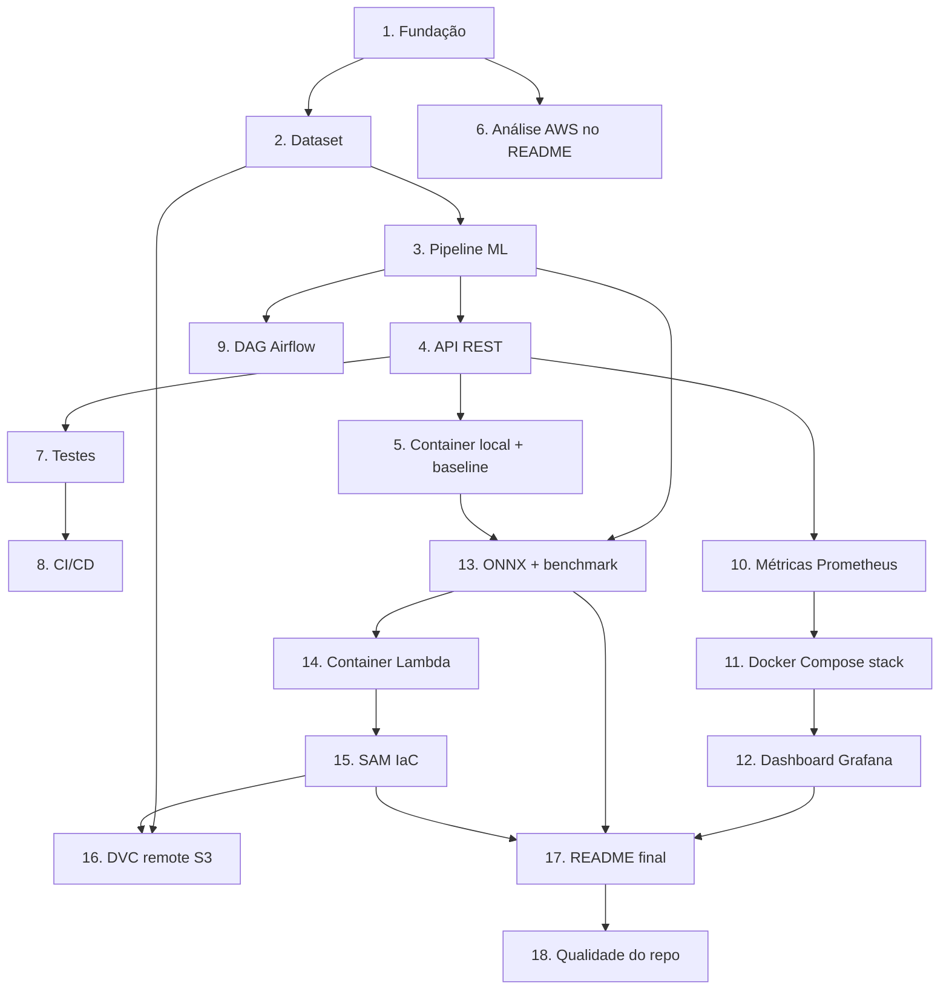

# Implementation Plan

## Overview

Plano de implementação incremental para o sistema de triagem de laudos médicos. As tarefas estão organizadas pelas 4 etapas do tech challenge e rastreadas aos requisitos (R1–R11). Cada tarefa é focada em escrita/modificação de código e construída sobre as anteriores. O fluxo geral é: fundação do projeto → dataset e modelo → API → container local e baseline → testes e CI/CD → DAG Airflow → monitoramento → otimização ONNX → deploy AWS (SAM) → entrega.

## Task Dependency Graph



```json
{
  "waves": [
    { "wave": 1, "tasks": ["1"] },
    { "wave": 2, "tasks": ["2", "6"] },
    { "wave": 3, "tasks": ["3", "16"] },
    { "wave": 4, "tasks": ["4", "9"] },
    { "wave": 5, "tasks": ["5", "7", "10"] },
    { "wave": 6, "tasks": ["8", "11", "13"] },
    { "wave": 7, "tasks": ["12", "14"] },
    { "wave": 8, "tasks": ["15"] },
    { "wave": 9, "tasks": ["17"] },
    { "wave": 10, "tasks": ["18"] }
  ]
}
```


## Tasks

### Etapa 0 — Fundação do projeto

- [x] 1. Estruturar o repositório e configuração base
  - Criar a estrutura de pastas (`src/api`, `src/model`, `src/data`, `scripts`, `monitoring`, `tests`, `airflow/dags`, `models`, `data`)
  - Criar `requirements.txt` com dependências (fastapi, uvicorn, scikit-learn, prometheus-client, onnxruntime, skl2onnx, joblib, mangum, pandas, pytest, ruff, bandit, dvc[s3])
  - Criar `pyproject.toml` com configuração de ruff, bandit e pytest
  - Criar `.gitignore` e `.dockerignore` (ignorar `data/*.csv`, `models/*.pkl`, `models/*.onnx`, caches)
  - _Requisitos: R8.1_

### Etapa 1 — Decisão arquitetural + API inicial

- [x] 2. Implementar geração/preparo do dataset
- [x] 2.1 Implementar o preparo do dataset público (Medical Abstracts TC Corpus)
  - Criar `src/data/prepare_dataset.py`: carregar o dataset público e mapear rótulos para `{normal, atencao, urgente}`
  - Gravar saída canônica em `data/laudos.csv` com colunas `text,label`
  - Documentar o mapeamento de rótulos em comentários/docstring
  - _Requisitos: R9.1, R9.2, R9.4, R9.5_
- [x] 2.2 Implementar fallback sintético para CI/offline
  - Criar `src/data/generate_dataset.py`: gerar >= 2.000 amostras rotuladas em inglês a partir de templates por classe, com seed fixa
  - _Requisitos: R9.2, R9.3, R9.8_

- [x] 3. Implementar o pipeline de ML (treino e inferência)
- [x] 3.1 Implementar pré-processamento e treino
  - Criar `src/model/preprocessing.py` (normalização) e `src/model/train.py` com `Pipeline(TfidfVectorizer + LogisticRegression)`, seed fixa, split estratificado
  - Avaliar (accuracy, f1 por classe) e persistir `models/model.pkl` + `models/metrics.json`
  - _Requisitos: R1.1, R1.3, R1.4, R1.6, R9.6, R9.7_
- [x] 3.2 Implementar o módulo de inferência
  - Criar `src/model/inference.py` com `predict(text) -> {label, score, scores}`, carregando ONNX (fallback `.pkl`)
  - Tratar texto vazio/inválido sinalizando erro de validação
  - _Requisitos: R1.1, R1.2, R1.5_

- [x] 4. Implementar a API REST (FastAPI)
- [x] 4.1 Definir schemas e endpoints
  - Criar `src/api/schemas.py` (Pydantic: request com `text` min_length 1; response com `label`, `score`, `scores`, `model_version`, `inference_ms`)
  - Criar `src/api/main.py` com `POST /predict`, `GET /health`; carregar o modelo no `lifespan` (uma vez)
  - _Requisitos: R2.1, R2.2, R2.3, R2.6, R1.5_
- [x] 4.2 Implementar tratamento de erros
  - 422 para `text` inválido; 503 quando modelo não carregado; 500 em falha de inferência (sem vazar stack trace)
  - _Requisitos: R2.4, R2.5_

- [x] 5. Containerizar a API (local) e medir baseline de latência
- [x] 5.1 Criar o Dockerfile local
  - Base `python:3.11-slim`, instalar deps, copiar `src/` e artefato, expor `8000`, CMD Uvicorn
  - _Requisitos: R3.1, R3.2, R3.3, R3.4, R3.5_
- [x] 5.2 Implementar script de benchmark de latência (baseline)
  - Criar `scripts/benchmark.py` medindo p50/p95/média sobre N requisições do modelo `.pkl` (baseline local)
  - _Requisitos: R7.2, R11.1_

- [x] 6. Escrever a análise de arquitetura AWS no README
  - Documentar batch vs. real-time e justificar real-time; descrever Lambda (container) + API Gateway + S3 + ECR; justificar Lambda vs. ECS/Fargate/EKS; registrar AMP + AMG como observabilidade gerenciada
  - _Requisitos: R10.1, R10.2, R10.3, R10.4, R10.5, R10.7, R10.9_

### Etapa 2 — CI/CD + pipeline de treino

- [x] 7. Escrever testes automatizados
- [x] 7.1 Testes de inferência
  - Criar `tests/test_inference.py`: label válido, score em [0,1], equivalência `.pkl` vs `.onnx` (tolerância)
  - _Requisitos: R8.4_
- [x] 7.2 Testes de API
  - Criar `tests/test_api.py` (TestClient): `/predict` 200 e 422, `/health` 200, `/metrics` 200 text/plain
  - _Requisitos: R8.4, R2.1, R2.3, R2.4_

- [x] 8. Configurar o pipeline CI/CD (GitHub Actions)
  - Criar `.github/workflows/ci.yml` disparado em push/PR: job `lint` (ruff, bloqueante), job `security` (bandit informacional, `continue-on-error`), job `test` (pytest, bloqueante), job `build` (docker build, `needs: [lint, test]`)
  - Garantir que falha de lint/test bloqueia build/merge; CI dedicado a MLOps (sem deploy AWS)
  - _Requisitos: R4.1, R4.2, R4.3, R4.4, R4.5, R4.6_

- [x] 9. Implementar a DAG do Airflow
  - Criar `airflow/dags/train_triage_model.py` com tarefas `load_data -> preprocess -> train -> evaluate -> export_onnx -> save_artifacts`, reusando funções de `src/model/`
  - `schedule_interval=None` (trigger manual), falha interrompe dependentes, persiste novo artefato
  - _Requisitos: R5.1, R5.2, R5.3, R5.4, R5.5_

### Etapa 3 — Monitoramento e observabilidade

- [x] 10. Instrumentar a API com métricas Prometheus
  - Criar `src/api/metrics.py`: Counter `http_requests_total` (method/endpoint/status), Histogram `http_request_duration_seconds`, Histogram `model_inference_duration_seconds`, Counter `prediction_total`
  - Expor `GET /metrics` via `generate_latest()`; aplicar middleware na app
  - _Requisitos: R6.1, R6.2_

- [x] 11. Criar a stack de monitoramento (Docker Compose)
  - Criar `docker-compose.yml` subindo API + Prometheus + Grafana
  - Criar `monitoring/prometheus/prometheus.yml` com scrape da API (`/metrics`, 15s)
  - _Requisitos: R6.3, R6.4_

- [x] 12. Provisionar o dashboard do Grafana
  - Criar `monitoring/grafana/provisioning/` (datasource + dashboard) e `monitoring/grafana/dashboards/triagem.json` com >= 3 painéis: total de requisições, latência (p95 via `histogram_quantile`), taxa de erro (status 5xx)
  - _Requisitos: R6.5, R6.6_

### Etapa 4 — Otimização de latência + deploy AWS + entrega

- [x] 13. Implementar exportação ONNX e benchmark comparativo
- [x] 13.1 Exportar o modelo para ONNX
  - Criar `src/model/export_onnx.py` convertendo o pipeline completo via `skl2onnx` para `models/model.onnx`
  - _Requisitos: R7.1_
- [x] 13.2 Comparar latência e acurácia (original vs. otimizado)
  - Estender `scripts/benchmark.py` para comparar `.pkl` vs `.onnx` (p50/p95/média, ganho %) e accuracy/f1; gravar `benchmark_results.md`/`.json`
  - Verificar meta p95 < 100 ms local e documentar trade-off de acurácia
  - _Requisitos: R7.2, R7.3, R7.4, R7.5, R11.1, R11.2, R11.3_

- [x] 14. Implementar o container e carregamento do modelo para AWS Lambda
  - Criar `Dockerfile.lambda` (base `public.ecr.aws/lambda/python:3.11`, handler via `mangum`)
  - Ajustar `src/api/main.py`/`inference.py` para carregar `model.onnx` do S3 no cold start (escopo global) usando env vars `MODEL_BUCKET`, `MODEL_KEY`, `MODEL_FORMAT`
  - _Requisitos: R3.1, R10.3, R10.4, R10.6_

- [x] 15. Criar a infraestrutura como código (AWS SAM) parametrizada
  - Criar `template.yaml`: `Serverless::Function` (PackageType Image), HttpApi, bucket S3, IAM Role (`s3:GetObject` + logs); `Parameters` (ModelBucketName, ModelKey, Stage, MemorySize, Timeout)
  - Criar `samconfig.toml` com parâmetros por ambiente; sem valores hardcoded
  - _Requisitos: R10.3, R10.4, R10.6, R10.8_

- [x] 16. Configurar DVC com remote S3
  - Inicializar DVC, criar `dvc.yaml` (estágio `prepare_dataset`), rastrear `data/laudos.csv`, configurar `.dvc/config` com remote S3 (mesmo bucket do modelo)
  - _Requisitos: R9.1, R10.6_

- [x] 17. Finalizar o README e documentação de entrega
  - Documentar: arquitetura, como rodar local, stack de monitoramento, pipeline, deploy SAM (`sam build`/`sam deploy --guided`), teardown (`sam delete`), parametrização, resultados de benchmark, link do vídeo STAR e lições aprendidas
  - _Requisitos: R8.3, R8.5, R11.4, R11.5, R11.6, R10.1_

- [x] 18. Garantir qualidade do repositório e versionamento
  - Revisar estrutura, aplicar commits semânticos (Conventional Commits) e confirmar que lint/bandit/testes passam localmente
  - _Requisitos: R8.1, R8.2, R8.4_

## Notes

- A meta de latência p95 < 100 ms refere-se ao ambiente local; o cold start da Lambda é tratado como tópico de arquitetura (provisioned concurrency opcional), não como meta de implementação.
- O GitHub Actions é dedicado a MLOps (lint, bandit, test, build); o deploy AWS via SAM é manual e documentado no README.
- O S3 é fonte única do artefato: remote do DVC (dados) e origem do `model.onnx` para a Lambda.
- O dataset público (Medical Abstracts TC Corpus) é a fonte primária; o gerador sintético é fallback para CI/offline.
- Tarefas sem código puro (ex.: 6, 17) são de documentação exigida pelo enunciado e permanecem no plano por serem entregáveis formais.
