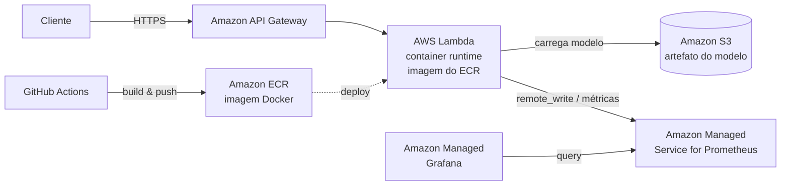

# Triagem Automática de Laudos Médicos

Sistema de triagem automática de laudos médicos que classifica a urgência de exames em
texto em três níveis — `normal`, `atencao`, `urgente` — usando um pipeline leve de NLP
(TF-IDF + Logistic Regression) servido por uma API REST (FastAPI) containerizada.

> Este README está em construção. Esta versão documenta a **análise de arquitetura de
> deploy em nuvem (AWS)**. As instruções de execução local, stack de monitoramento,
> pipeline de treino, deploy via SAM, resultados de benchmark e link do vídeo serão
> consolidados na entrega final.

## Arquitetura de Deploy em Nuvem (AWS)

Esta seção documenta a decisão arquitetural de deploy em nuvem exigida pela Etapa 1 do
tech challenge: a escolha entre inferência em **batch** e em **tempo real (real-time)**, a
arquitetura-alvo na AWS e sua justificativa frente a alternativas, além da estratégia de
observabilidade gerenciada em produção.

### Batch vs. Real-time — por que real-time

O cenário é a triagem de laudos de um hospital de referência, cujo objetivo é **priorizar
rapidamente casos urgentes**. Isso define naturalmente o modo de inferência adequado.

| Critério | Batch (lote) | Real-time (tempo real) |
|----------|--------------|------------------------|
| Latência percebida | Alta — resultados saem em janelas periódicas | Baixa — resposta por requisição, imediata |
| Adequação à urgência | Inadequada — um laudo urgente aguardaria o próximo lote | Adequada — classificação disponível no ato do envio |
| Padrão de uso | Grandes volumes processados de forma agendada | Requisições individuais, sob demanda, integráveis |
| Integração hospitalar | Exporta/importa arquivos periodicamente | API consumida de forma programática por sistemas clientes |

**Decisão: real-time.** A triagem precisa sinalizar urgência no momento em que o laudo é
submetido; qualquer atraso de janela de lote comprometeria o objetivo clínico de priorização.
A inferência é, por natureza, uma operação individual e de baixa latência (produto
vetor-matriz esparsa do pipeline TF-IDF + Logistic Regression), com meta de p95 < 100 ms em
ambiente local. Isso torna o processamento em batch desnecessário e contraproducente para o
caso de uso. _(R10.1, R10.2)_

A escolha de real-time é **consistente com a implementação do projeto**: uma API REST
(FastAPI) empacotada em container Docker, a mesma base de código servida localmente e na
nuvem (via adaptador `mangum` para o ambiente Lambda), sem divergência de comportamento entre
desenvolvimento e produção. _(R10.8)_

### Arquitetura-alvo na AWS

A arquitetura de produção na AWS entrega a inferência real-time através dos seguintes
componentes gerenciados:

- **Amazon API Gateway** à frente, expondo publicamente os endpoints HTTPS (`/predict`,
  `/health`, `/metrics`) e roteando as requisições para a função de inferência. _(R10.4)_
- **AWS Lambda com runtime de container**, executando a mesma API FastAPI (via `mangum`) a
  partir de uma imagem Docker. É a unidade de execução do container de inferência, com escala
  automática sob demanda. _(R10.3)_
- **Amazon ECR (Elastic Container Registry)**, onde a imagem Docker da função é publicada e de
  onde a Lambda extrai o container para execução. _(R10.3)_
- **Amazon S3**, para armazenamento e versionamento do artefato do modelo (`model.onnx`). O
  mesmo bucket é a fonte única de verdade do artefato — remote do DVC para os dados de treino e
  origem do modelo carregado pela Lambda em runtime. _(R10.6)_

No **cold start**, a função carrega o `model.onnx` do S3 (em escopo global, fora do handler de
invocação) e inicializa a sessão de inferência uma única vez; em invocações **warm** a sessão
já carregada é reutilizada, sem novo download. O bucket e a chave do modelo são passados por
variável de ambiente, nunca hardcoded.

### Por que Lambda (container) + API Gateway, e não ECS/Fargate ou EKS

A escolha de **AWS Lambda com runtime de container atrás do API Gateway** se justifica frente a
alternativas de orquestração de containers (ECS/Fargate, EKS) considerando o perfil do
workload: requisições individuais, esporádicas/variáveis, de inferência leve e baixa latência.

| Critério | Lambda (container) + API Gateway | ECS / Fargate | EKS (Kubernetes) |
|----------|----------------------------------|---------------|------------------|
| Escala sob demanda | Automática, incluindo **scale-to-zero** (sem custo ocioso) | Requer tarefas/serviços rodando; auto scaling configurável, sem zero real prático | Requer cluster e workloads sempre ativos |
| Cold start | Presente (mitigável com artefato ONNX pequeno + carga em escopo global; _provisioned concurrency_ opcional) | Baixo em serviço quente, mas exige capacidade provisionada | Baixo em pods quentes, exige capacidade provisionada |
| Custo | Pago por invocação/execução; econômico sob carga intermitente | Pago pelo tempo de tarefa ativa, mesmo ocioso | Custo de control plane + nós, mesmo ocioso |
| Simplicidade operacional | Alta — sem servidores/cluster para gerenciar | Média — definição de tarefas, serviços, balanceador | Baixa — operar e manter cluster Kubernetes |
| Latência | Adequada ao workload leve; ótima quando warm | Previsível e baixa com serviço quente | Previsível e baixa com pods quentes |

**Justificativa.** Para um serviço de inferência leve, com tráfego sob demanda e meta de baixa
latência, o Lambda com runtime de container oferece o melhor equilíbrio: escala automática
até zero (sem custo quando não há tráfego), simplicidade operacional (sem cluster para
operar) e integração nativa com o API Gateway para expor a API HTTPS. ECS/Fargate e EKS
agregam capacidade e custo ociosos e complexidade operacional que não se pagam neste cenário.
O principal trade-off do Lambda é o **cold start**, mitigado pelo artefato ONNX compacto, pelo
carregamento do modelo em escopo global (reaproveitado entre invocações warm) e, opcionalmente,
por _provisioned concurrency_ — tratado como tópico de arquitetura, não como meta de
implementação local. _(R10.5)_

### Observabilidade gerenciada em produção (AMP + AMG)

A arquitetura de observabilidade em nuvem usa os equivalentes **gerenciados** da stack local:

- **Amazon Managed Service for Prometheus (AMP)** como backend gerenciado de métricas, recebendo
  as séries da aplicação (via `remote_write`) — equivalente gerenciado ao Prometheus local.
- **Amazon Managed Grafana (AMG)** como camada de visualização, consultando o AMP — equivalente
  gerenciado ao Grafana local.

Isso reaproveita a instrumentação da API (`prometheus-client`, endpoint `/metrics`) sem
reescrever a lógica de observabilidade: as mesmas métricas (total de requisições, latência,
taxa de erro) que alimentam os dashboards locais alimentam o AMG em produção. _(R10.7)_

**Local vs. nuvem — não são conflitantes.** A stack de monitoramento **local** (Docker Compose
com Prometheus + Grafana, do Requisito 6) é usada para **desenvolvimento e demonstração**,
enquanto **AMP + AMG** são o alvo gerenciado em **produção**. A escolha deixa explícito que a
observabilidade local e a de nuvem são a mesma abordagem (Prometheus + Grafana) em versões
auto-hospedada e gerenciada, respectivamente. _(R10.9)_
