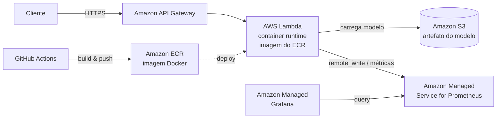

# Triagem Automática de Laudos Médicos

Sistema de triagem automática de laudos médicos que classifica a urgência de exames em
texto em três níveis — `normal`, `atencao`, `urgente` — usando um pipeline leve de NLP
(TF-IDF + Logistic Regression) servido por uma API REST (FastAPI) containerizada.

O foco do projeto (Tech Challenge — Fase 3) é demonstrar um **ciclo de MLOps completo,
observável e de baixa latência**: dataset reprodutível, pipeline de treino, API em
container, CI/CD (GitHub Actions), orquestração de retreino (Airflow), monitoramento
(Prometheus + Grafana), otimização de inferência (ONNX) e deploy em nuvem (AWS SAM).

## Índice

- [Visão geral e arquitetura](#visão-geral-e-arquitetura)
- [Pré-requisitos de ambiente](#pré-requisitos-de-ambiente)
- [Como rodar localmente](#como-rodar-localmente)
- [Stack de monitoramento](#stack-de-monitoramento)
- [Pipeline CI/CD e DAG do Airflow](#pipeline-cicd-e-dag-do-airflow)
- [Deploy na AWS (SAM)](#deploy-na-aws-sam)
- [Versionamento de dados (DVC)](#versionamento-de-dados-dvc)
- [Resultados de benchmark](#resultados-de-benchmark)
- [Vídeo STAR](#vídeo-star)
- [Lições aprendidas](#lições-aprendidas)
- [Estrutura do repositório](#estrutura-do-repositório)
- [Convenção de commits](#convenção-de-commits)
- [Arquitetura de Deploy em Nuvem (AWS)](#arquitetura-de-deploy-em-nuvem-aws)

## Visão geral e arquitetura

O sistema recebe o texto de um laudo médico (em inglês) e devolve a classe de urgência
prevista, a confiança (score) e a distribuição de probabilidade por classe. O coração é um
pipeline `TfidfVectorizer + LogisticRegression` (Scikit-Learn), treinado com seed fixa e
exportado para **ONNX** para inferência de baixa latência.

**Pipeline de ML:**

```
dataset (data/laudos.csv) → TF-IDF + LogisticRegression → models/model.pkl
                                                        → export ONNX → models/model.onnx
```

A inferência carrega preferencialmente o `model.onnx` (fallback para `model.pkl`), de modo
que a API, o container local e a Lambda compartilham a mesma lógica de predição.

**Arquitetura local (Docker Compose):** três serviços integrados em uma rede compartilhada
— a **API** FastAPI (porta 8000), o **Prometheus** (porta 9090, scrape de `/metrics` a cada
15s) e o **Grafana** (porta 3000, dashboard provisionado por arquivo). Usada para
desenvolvimento e demonstração.

**Arquitetura de nuvem (AWS):** a mesma imagem roda em **AWS Lambda** (runtime de container,
via `mangum`) atrás do **Amazon API Gateway**, com o artefato do modelo no **Amazon S3** e a
imagem publicada no **Amazon ECR**. A análise completa de decisão arquitetural (batch vs.
real-time, Lambda vs. ECS/EKS, observabilidade gerenciada AMP + AMG) está documentada na
seção [Arquitetura de Deploy em Nuvem (AWS)](#arquitetura-de-deploy-em-nuvem-aws).

## Pré-requisitos de ambiente

| Ferramenta | Versão | Para quê |
|------------|--------|----------|
| Python | 3.11 | treino, inferência e API |
| pip | recente | instalar dependências (`requirements.txt`) |
| Docker | com Compose v2 | container da API e stack de monitoramento |
| AWS CLI | v2 | credenciais e `aws s3 cp` (deploy/DVC) |
| AWS SAM CLI | recente | build e deploy da infraestrutura (`sam ...`) |
| Git | recente | versionamento de código |

Observações:
- O deploy AWS (SAM, S3, ECR, DVC remote) exige credenciais AWS configuradas no ambiente do
  operador (perfil da AWS CLI / SSO / variáveis de ambiente). **Nenhum segredo é commitado**
  no repositório.
- Para rodar apenas localmente (treino + API + monitoramento), bastam Python 3.11 e Docker.

## Como rodar localmente

### 1. Instalar dependências

```bash
python -m venv .venv
source .venv/bin/activate        # Windows: .venv\Scripts\activate
pip install -r requirements.txt
```

### 2. Preparar o dataset

Fonte primária — **Medical Abstracts TC Corpus** (dataset público em inglês, > 2.000
amostras), com os rótulos de condição mapeados para urgência (`normal`/`atencao`/`urgente`):

```bash
python -m src.data.prepare_dataset
```

Fallback sintético (para CI/offline, gera um dataset determinístico com seed fixa):

```bash
python -m src.data.generate_dataset
```

Ambos gravam a saída canônica em `data/laudos.csv` com as colunas `text,label`. Se o treino
rodar sem `data/laudos.csv` presente, o fallback sintético é gerado automaticamente.

### 3. Treinar o modelo

```bash
python -m src.model.train
```

Gera `models/model.pkl` e `models/metrics.json` (accuracy e F1 por classe), com split
estratificado reprodutível (seed 42).

### 4. Exportar para ONNX

```bash
python -m src.model.export_onnx
```

Converte o pipeline completo para `models/model.onnx` (usado pela inferência de baixa
latência).

### 5. Rodar a API

Direto com Uvicorn:

```bash
uvicorn src.api.main:app --host 0.0.0.0 --port 8000
```

Ou via Docker:

```bash
docker build -f Dockerfile -t triagem-laudos-api:local .
docker run --rm -p 8000:8000 triagem-laudos-api:local
```

### 6. Chamar os endpoints

```bash
# Predição
curl -s -X POST http://localhost:8000/predict \
  -H "Content-Type: application/json" \
  -d '{"text": "Patient presents with acute chest pain and shortness of breath"}'
# -> {"label":"urgente","score":0.93,"scores":{...},"model_version":"onnx-v1","inference_ms":4.1}

# Health check
curl -s http://localhost:8000/health
# -> {"status":"ok","model_loaded":true,"model_version":"onnx-v1"}

# Métricas Prometheus (text/plain)
curl -s http://localhost:8000/metrics
```

Respostas de erro: `422` para `text` vazio/inválido, `503` se o modelo não estiver
carregado, `500` em falha inesperada de inferência (mensagem genérica, sem vazar stack
trace).

## Stack de monitoramento

A stack local sobe API + Prometheus + Grafana via Docker Compose:

```bash
docker compose up --build
```

| Serviço | URL | Observações |
|---------|-----|-------------|
| API | http://localhost:8000 | `/predict`, `/health`, `/metrics` |
| Prometheus | http://localhost:9090 | scrape de `api:8000/metrics` a cada 15s |
| Grafana | http://localhost:3000 | login `admin` / `admin` (apenas demo local) |

O Grafana vem com datasource (Prometheus) e dashboard **provisionados por arquivo**
(`monitoring/grafana/provisioning/` + `monitoring/grafana/dashboards/triagem.json`), então
os painéis aparecem automaticamente ao subir a stack. O dashboard tem no mínimo 3 painéis:

- Total de requisições (`http_requests_total`);
- Latência p95 (`histogram_quantile` sobre `http_request_duration_seconds`);
- Taxa de erro (requisições com status 5xx).

A API é instrumentada com `prometheus-client` e expõe as métricas em `GET /metrics`
(counters de requisições e predições; histogramas de duração HTTP e de inferência do modelo).

## Pipeline CI/CD e DAG do Airflow

### CI/CD (GitHub Actions)

Workflow em `.github/workflows/ci.yml`, disparado em cada `push` e `pull_request`.
Dedicado a MLOps (**sem deploy AWS** — o `sam deploy` é manual). Estrutura encadeada:

```
lint ──┐
       ├─► build   (needs: [lint, test])
test ──┘
security (bandit, informacional, não bloqueia)
```

- **lint** — `ruff check src tests` (bloqueante).
- **security** — `bandit -c pyproject.toml -r src` (informacional, `continue-on-error`).
- **test** — `pytest` (bloqueante); treina o modelo antes para gerar `models/model.pkl`.
- **build** — `docker build` da imagem de inferência (só após lint **e** test passarem).

Se lint ou testes falharem, o build não roda e o merge é bloqueado.

### DAG do Airflow

A DAG `train_triage_model` (`airflow/dags/train_triage_model.py`) orquestra o
treino/retreino reaproveitando as funções de `src/model/` e `src/data/`:

```
load_data → preprocess → train → evaluate → export_onnx → save_artifacts
```

- `schedule=None` → **execução manual por trigger** (o agendamento periódico é possível
  trocando `schedule`, ex. `"@weekly"` — mantido comentado no código).
- O encadeamento linear faz com que a falha de qualquer tarefa interrompa as dependentes.
- Em caso de sucesso, `save_artifacts` persiste um novo artefato (`models/model.pkl` +
  `models/metrics.json`).

#### Demonstrar localmente (Docker Compose)

A pasta `airflow/` traz uma stack local pronta (`airflow/docker-compose.yml` +
`airflow/Dockerfile`) para **demonstrar a DAG de ponta a ponta** com a UI do
Airflow. A imagem estende o Airflow oficial e instala as libs de ML do projeto
(scikit-learn, pandas, onnx/onnxruntime, skl2onnx) para que os callables da DAG
— que reutilizam `src/model` e `src/data` — rodem no worker. A raiz do projeto é
montada no container, então os artefatos gerados (`models/model.pkl`,
`models/metrics.json`) aparecem no host.

```bash
cd airflow
docker compose up --build        # sobe postgres + init + webserver + scheduler
# UI: http://localhost:8080  (login: admin / admin)
```

Na UI, localize a DAG `train_triage_model`, ative-a e acione o **Trigger DAG**;
acompanhe o grafo e os logs por tarefa. Pela linha de comando (dentro de um dos
containers do Airflow) o equivalente é:

```bash
docker compose exec airflow-scheduler airflow dags trigger train_triage_model
```

Encerrar a stack (use `-v` para também apagar o metadado do Postgres):

```bash
docker compose down
```

> Sem dados em `data/laudos.csv`, a tarefa `load_data` gera o dataset sintético
> determinístico automaticamente — a demo funciona offline.

## Deploy na AWS (SAM)

A infraestrutura é descrita como código em `template.yaml` (AWS SAM) e parametrizada por
ambiente em `samconfig.toml`. Provisiona: função Lambda (imagem de container, via
`Dockerfile.lambda`), HTTP API (API Gateway), bucket S3 do modelo e a IAM Role (gerada pelo
SAM) com `s3:GetObject` + logs no CloudWatch.

### Pré-requisitos

- AWS CLI v2 e AWS SAM CLI instalados; credenciais AWS configuradas no ambiente.
- Docker em execução (o SAM constrói a imagem do container).

### Build e deploy

```bash
sam build

# Primeira vez (interativo, grava respostas no samconfig.toml):
sam deploy --guided

# Próximos deploys (usa [default] do samconfig.toml):
sam deploy
```

A URL do HTTP API é exibida nos `Outputs` do stack (`ApiEndpoint`).

### Testar a API publicada

Com o stack implantado, use a URL do `ApiEndpoint` (o path inclui o stage,
ex.: `/dev`). Exemplo com o endpoint atual de ambiente de desenvolvimento:

```bash
API="https://544wv6xtq1.execute-api.us-east-1.amazonaws.com/dev"

# Health check
curl -s "$API/health"
# -> {"status":"ok","model_loaded":true,"model_version":"onnx-v1"}

# Predição
curl -s -X POST "$API/predict" \
  -H "Content-Type: application/json" \
  -d '{"text": "Patient presents with acute chest pain and shortness of breath"}'

# Métricas Prometheus (text/plain)
curl -s "$API/metrics"
```

Exemplos de `/predict` por classe de urgência (os mesmos laudos usados nos
testes de inferência, um por classe):

```bash
# normal — acompanhamento de rotina, achados dentro dos limites normais
curl -s -X POST "$API/predict" -H "Content-Type: application/json" \
  -d '{"text": "Routine follow-up for stable chronic condition. Findings within normal limits."}'

# atencao — quadro que requer avaliação e monitoramento adicionais
curl -s -X POST "$API/predict" -H "Content-Type: application/json" \
  -d '{"text": "Persistent abdominal pain that warrants further evaluation and monitoring."}'

# urgente — dor torácica aguda com sinais de falência de órgão
curl -s -X POST "$API/predict" -H "Content-Type: application/json" \
  -d '{"text": "Patient presents with acute crushing chest pain and signs of organ failure."}'
```

> A classe prevista depende do modelo treinado; os textos acima são
> representativos de cada nível, mas o `label` retornado pode variar conforme
> o dataset e o treino correntes.

> URL de health direta (dev): https://544wv6xtq1.execute-api.us-east-1.amazonaws.com/dev/health
>
> URL de métricas direta (dev): https://544wv6xtq1.execute-api.us-east-1.amazonaws.com/dev/metrics
>
> O endpoint acima é de uma implantação de desenvolvimento e pode mudar a
> cada novo deploy; sempre confira o `ApiEndpoint` nos `Outputs` do stack.

### Upload do modelo para o S3

A Lambda carrega `model.onnx` do S3 no cold start, então o artefato precisa estar no bucket
após o deploy. Use o DVC ou o AWS CLI:

```bash
# via DVC (remote S3 configurado — ver seção DVC)
dvc push

# ou diretamente
aws s3 cp models/model.onnx s3://<ModelBucketName>/model.onnx
```

Troque `<ModelBucketName>` pelo nome real do bucket (o mesmo definido em `samconfig.toml`).

### Parametrização (sem valores hardcoded)

A configuração é 100% parametrizada:

- **`template.yaml` → `Parameters`:** `ModelBucketName`, `ModelKey` (default `model.onnx`),
  `ModelFormat` (`onnx`/`pkl`), `Stage`, `MemorySize`, `Timeout`.
- **`samconfig.toml`:** `parameter_overrides` por ambiente (`[default]` = dev,
  `[prod]` = prod). O `ModelBucketName` traz um placeholder (`...-change-me`) que **deve ser
  trocado** por um nome globalmente único no S3.
- **Variáveis de ambiente da Lambda:** `MODEL_BUCKET`, `MODEL_KEY`, `MODEL_FORMAT` — lidas
  pela aplicação em runtime. Localmente essas variáveis não existem e o modelo é carregado do
  diretório `models/`.

Deploy em outro ambiente:

```bash
sam deploy --config-env prod
```

### Teardown

Para destruir o stack (atenção: operação destrutiva e, no caso do S3, exige o bucket vazio):

```bash
# 1. Esvaziar o bucket do modelo antes de deletar o stack
aws s3 rm s3://<ModelBucketName> --recursive

# 2. Remover o stack
sam delete                       # ou: sam delete --config-env prod
```

## Versionamento de dados (DVC)

O DVC versiona o dataset (`data/laudos.csv`) com remote em **Amazon S3 — o mesmo bucket do
modelo** (o S3 é fonte única: dados via DVC sob o prefixo `/dvc` e `model.onnx` para a
Lambda). A configuração está em `.dvc/config` e o pipeline em `dvc.yaml` (estágio
`prepare_dataset`).

```bash
# Reproduzir o estágio de preparo do dataset
dvc repro

# Enviar/baixar dados versionados do remote S3
dvc push
dvc pull
```

> O `url` do remote em `.dvc/config` usa o **mesmo placeholder** de bucket do
> `samconfig.toml` (`triagem-laudos-model-dev-change-me`). Troque-o pelo nome real do bucket
> (globalmente único) e mantenha-o alinhado ao `ModelBucketName` do deploy SAM antes de
> `dvc push`/`dvc pull`. Credenciais AWS são resolvidas pelo ambiente, nunca commitadas.

## Resultados de benchmark

Benchmark de latência e acurácia comparando o modelo **original (`.pkl`)** vs. **otimizado
(`.onnx`)**, medido com `scripts/benchmark.py` sobre 1000 requisições cronometradas (warmup
de 50). Os números abaixo reproduzem `benchmark_results.md`.

Há **dois scripts complementares** de medição:

- `scripts/benchmark.py` — mede o modelo **em processo** (carrega o `.pkl`/`.onnx`
  diretamente) e compara original vs. otimizado; gera `benchmark_results.{json,md}`.
- `scripts/load_test.py` — dispara **N inferências `POST /predict` em sequência contra a
  API em execução**, medindo a latência end-to-end (inclui rede/HTTP) e gerando um log por
  requisição. Como bate no endpoint real, também **popula as métricas Prometheus** (`/metrics`)
  e os logs do servidor — útil para demonstrar os painéis do Grafana. Usa só a biblioteca
  padrão, então funciona contra o Compose local ou a URL publicada na AWS.

```bash
# local (API do docker-compose na porta 8000)
python scripts/load_test.py --url http://localhost:8000 --n 500

# contra a API publicada (inclua o stage no path)
python scripts/load_test.py --url "$API" --n 200

# laudos customizados (um por linha) e arquivos de saída
python scripts/load_test.py --input laudos.txt \
  --log-file run.log --summary-json run.json
```

Saída: um resumo no console (p50/p95/média, status, distribuição de classes), um log
tab-separado por requisição (`load_test.log`) e um resumo estruturado (`load_test_results.json`)
— ambos artefatos gerados (gitignored).

### Latência (ms)

| Métrica | Original (.pkl) | Otimizado (.onnx) | Ganho |
|---------|-----------------|-------------------|-------|
| p50 | 1.164 | 0.898 | +22.8% |
| p95 | 1.403 | 1.197 | +14.6% |
| média | 1.199 | 0.933 | +22.2% |

> Ganho = `(original - otimizado) / original`; positivo indica ONNX mais rápido.

### Meta p95 < 100 ms (local, R7.4)

- Modelo avaliado: **otimizado (.onnx)** — p95 = **1.197 ms** / alvo < 100 ms.
- Veredito: **✅ PASS** (folga de ~2 ordens de grandeza sobre a meta).

### Acurácia / F1 (trade-off, R7.5)

| Modelo | Accuracy | F1 macro | F1 normal | F1 atencao | F1 urgente |
|--------|----------|----------|-----------|------------|------------|
| Original (.pkl) | 0.5790 | 0.5569 | 0.4547 | 0.5144 | 0.7016 |
| Otimizado (.onnx) | 0.5960 | 0.5744 | 0.4713 | 0.5390 | 0.7130 |

A otimização via ONNX Runtime **não degradou a acurácia** (o ONNX ficou igual ou
ligeiramente superior ao original); o ganho de latência vem sem trade-off de qualidade. O
objetivo do projeto (ciclo de MLOps de baixa latência) é atendido sem comprometer a triagem.

## Vídeo STAR

[Vídeo STAR](URL_A_PREENCHER)

> **Substituir `URL_A_PREENCHER` pelo link do vídeo.** O vídeo (até 5 minutos, método STAR:
> Situation, Task, Action, Result) deve demonstrar o pipeline em execução, a latência
> alcançada (p95 < 100 ms local) e as lições aprendidas.

## Lições aprendidas

- **TF-IDF + LogisticRegression** é um trade-off deliberado: a acurácia não é o foco, mas o
  modelo é rápido, compacto, reprodutível e totalmente exportável para ONNX — ideal para o
  ciclo de MLOps e para a meta de latência.
- **Ganho com ONNX Runtime:** inferência mais rápida (p95 ~15% melhor, p50/média ~22%) sem
  perda de acurácia, com artefato pequeno que ajuda o cold start da Lambda.
- **Cold start da Lambda:** mitigado carregando o modelo em escopo global (reaproveitado
  entre invocações warm) e com o artefato ONNX compacto; _provisioned concurrency_ é uma
  opção de arquitetura, não meta de implementação.
- **S3 como fonte única:** o mesmo bucket versiona os dados (remote DVC) e serve o modelo
  para a Lambda, evitando divergência de artefatos entre dados e produção.
- **Bandit informacional:** a análise de segurança roda no CI mas não bloqueia, mantendo o
  pipeline fluido enquanto dá visibilidade aos findings.
- **Parametrização total do IaC:** nada de valores hardcoded — tudo em `Parameters` +
  `samconfig.toml` + env vars, com credenciais resolvidas pelo ambiente do operador.

## Estrutura do repositório

```
.
├── src/
│   ├── api/        # FastAPI: main.py, schemas.py, metrics.py
│   ├── model/      # train, inference, preprocessing, export_onnx
│   └── data/       # prepare_dataset (público) e generate_dataset (sintético)
├── airflow/        # DAG train_triage_model + stack de demo (compose + Dockerfile)
│   ├── dags/       # DAG train_triage_model
│   ├── Dockerfile  # imagem Airflow + libs de ML do projeto
│   └── docker-compose.yml  # stack local do Airflow (demo da DAG)
├── monitoring/     # prometheus.yml + provisioning e dashboards do Grafana
├── scripts/        # benchmark.py (in-process) e load_test.py (driver HTTP)
├── tests/          # testes de API e inferência
├── models/         # artefatos (model.pkl / model.onnx — gitignored)
├── data/           # laudos.csv (versionado via DVC)
├── Dockerfile      # imagem local da API
├── Dockerfile.lambda  # imagem para AWS Lambda (mangum)
├── docker-compose.yml # stack de monitoramento local
├── template.yaml   # AWS SAM (IaC)
├── samconfig.toml  # parâmetros de deploy por ambiente
├── dvc.yaml        # pipeline DVC (prepare_dataset)
└── .github/workflows/ci.yml  # pipeline CI/CD
```

## Convenção de commits

O repositório segue [Conventional Commits](https://www.conventionalcommits.org/) para
manter um histórico semântico e legível. O formato é:

```
<tipo>(<escopo opcional>): <descrição no imperativo>
```

Tipos usados no projeto:

| Tipo | Uso |
|------|-----|
| `feat` | nova funcionalidade (ex.: `feat(api): adicionar endpoint /predict`) |
| `fix` | correção de bug |
| `docs` | documentação (README, docstrings, specs) |
| `test` | adição ou ajuste de testes |
| `build` | build/dependências (Dockerfile, requirements.txt, pyproject) |
| `ci` | pipeline de CI/CD (GitHub Actions) |
| `chore` | tarefas de manutenção sem impacto em código de produção |
| `refactor` | refatoração sem mudança de comportamento |

Escopos comuns: `api`, `model`, `data`, `monitoring`, `airflow`, `sam`, `dvc`.

Exemplos:

```
feat(model): exportar pipeline para ONNX via skl2onnx
feat(api): instrumentar métricas Prometheus em /metrics
build(deps): fixar pathspec<1.0 para install reprodutível do DVC
ci: adicionar jobs lint, security e test ao pipeline
docs: documentar deploy SAM e teardown no README
test(api): cobrir respostas 422 e 503 do /predict
```

## Arquitetura de Deploy em Nuvem (AWS)

Esta seção documenta a decisão arquitetural de deploy em nuvem exigida pela Etapa 1 do
tech challenge: a escolha entre inferência em **batch** e em **tempo real (real-time)**, a
arquitetura-alvo na AWS e sua justificativa frente a alternativas, além da estratégia de
observabilidade gerenciada em produção.

### Batch vs. Real-time — por que real-time

O cenário é a triagem de laudos de um hospital de referência, cujo objetivo é **priorizar
rapidamente casos urgentes**. Isso define naturalmente o modo de inferência adequado.

| Critério | Batch (lote) | Real-time (tempo real) |
|----------|--------------|------------------------|
| Latência percebida | Alta — resultados saem em janelas periódicas | Baixa — resposta por requisição, imediata |
| Adequação à urgência | Inadequada — um laudo urgente aguardaria o próximo lote | Adequada — classificação disponível no ato do envio |
| Padrão de uso | Grandes volumes processados de forma agendada | Requisições individuais, sob demanda, integráveis |
| Integração hospitalar | Exporta/importa arquivos periodicamente | API consumida de forma programática por sistemas clientes |

**Decisão: real-time.** A triagem precisa sinalizar urgência no momento em que o laudo é
submetido; qualquer atraso de janela de lote comprometeria o objetivo clínico de priorização.
A inferência é, por natureza, uma operação individual e de baixa latência (produto
vetor-matriz esparsa do pipeline TF-IDF + Logistic Regression), com meta de p95 < 100 ms em
ambiente local. Isso torna o processamento em batch desnecessário e contraproducente para o
caso de uso. _(R10.1, R10.2)_

A escolha de real-time é **consistente com a implementação do projeto**: uma API REST
(FastAPI) empacotada em container Docker, a mesma base de código servida localmente e na
nuvem (via adaptador `mangum` para o ambiente Lambda), sem divergência de comportamento entre
desenvolvimento e produção. _(R10.8)_

### Arquitetura-alvo na AWS

A arquitetura de produção na AWS entrega a inferência real-time através dos seguintes
componentes gerenciados:

- **Amazon API Gateway** à frente, expondo publicamente os endpoints HTTPS (`/predict`,
  `/health`, `/metrics`) e roteando as requisições para a função de inferência. _(R10.4)_
- **AWS Lambda com runtime de container**, executando a mesma API FastAPI (via `mangum`) a
  partir de uma imagem Docker. É a unidade de execução do container de inferência, com escala
  automática sob demanda. _(R10.3)_
- **Amazon ECR (Elastic Container Registry)**, onde a imagem Docker da função é publicada e de
  onde a Lambda extrai o container para execução. _(R10.3)_
- **Amazon S3**, para armazenamento e versionamento do artefato do modelo (`model.onnx`). O
  mesmo bucket é a fonte única de verdade do artefato — remote do DVC para os dados de treino e
  origem do modelo carregado pela Lambda em runtime. _(R10.6)_

No **cold start**, a função carrega o `model.onnx` do S3 (em escopo global, fora do handler de
invocação) e inicializa a sessão de inferência uma única vez; em invocações **warm** a sessão
já carregada é reutilizada, sem novo download. O bucket e a chave do modelo são passados por
variável de ambiente, nunca hardcoded.



### Por que Lambda (container) + API Gateway, e não ECS/Fargate ou EKS

A escolha de **AWS Lambda com runtime de container atrás do API Gateway** se justifica frente a
alternativas de orquestração de containers (ECS/Fargate, EKS) considerando o perfil do
workload: requisições individuais, esporádicas/variáveis, de inferência leve e baixa latência.

| Critério | Lambda (container) + API Gateway | ECS / Fargate | EKS (Kubernetes) |
|----------|----------------------------------|---------------|------------------|
| Escala sob demanda | Automática, incluindo **scale-to-zero** (sem custo ocioso) | Requer tarefas/serviços rodando; auto scaling configurável, sem zero real prático | Requer cluster e workloads sempre ativos |
| Cold start | Presente (mitigável com artefato ONNX pequeno + carga em escopo global; _provisioned concurrency_ opcional) | Baixo em serviço quente, mas exige capacidade provisionada | Baixo em pods quentes, exige capacidade provisionada |
| Custo | Pago por invocação/execução; econômico sob carga intermitente | Pago pelo tempo de tarefa ativa, mesmo ocioso | Custo de control plane + nós, mesmo ocioso |
| Simplicidade operacional | Alta — sem servidores/cluster para gerenciar | Média — definição de tarefas, serviços, balanceador | Baixa — operar e manter cluster Kubernetes |
| Latência | Adequada ao workload leve; ótima quando warm | Previsível e baixa com serviço quente | Previsível e baixa com pods quentes |

**Justificativa.** Para um serviço de inferência leve, com tráfego sob demanda e meta de baixa
latência, o Lambda com runtime de container oferece o melhor equilíbrio: escala automática
até zero (sem custo quando não há tráfego), simplicidade operacional (sem cluster para
operar) e integração nativa com o API Gateway para expor a API HTTPS. ECS/Fargate e EKS
agregam capacidade e custo ociosos e complexidade operacional que não se pagam neste cenário.
O principal trade-off do Lambda é o **cold start**, mitigado pelo artefato ONNX compacto, pelo
carregamento do modelo em escopo global (reaproveitado entre invocações warm) e, opcionalmente,
por _provisioned concurrency_ — tratado como tópico de arquitetura, não como meta de
implementação local. _(R10.5)_

### Observabilidade gerenciada em produção (AMP + AMG)

A arquitetura de observabilidade em nuvem usa os equivalentes **gerenciados** da stack local:

- **Amazon Managed Service for Prometheus (AMP)** como backend gerenciado de métricas, recebendo
  as séries da aplicação (via `remote_write`) — equivalente gerenciado ao Prometheus local.
- **Amazon Managed Grafana (AMG)** como camada de visualização, consultando o AMP — equivalente
  gerenciado ao Grafana local.

Isso reaproveita a instrumentação da API (`prometheus-client`, endpoint `/metrics`) sem
reescrever a lógica de observabilidade: as mesmas métricas (total de requisições, latência,
taxa de erro) que alimentam os dashboards locais alimentam o AMG em produção. _(R10.7)_

**Local vs. nuvem — não são conflitantes.** A stack de monitoramento **local** (Docker Compose
com Prometheus + Grafana, do Requisito 6) é usada para **desenvolvimento e demonstração**,
enquanto **AMP + AMG** são o alvo gerenciado em **produção**. A escolha deixa explícito que a
observabilidade local e a de nuvem são a mesma abordagem (Prometheus + Grafana) em versões
auto-hospedada e gerenciada, respectivamente. _(R10.9)_
